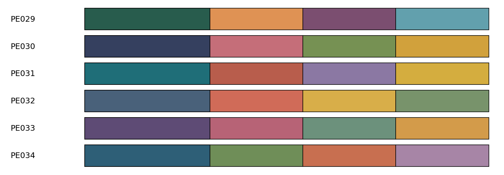
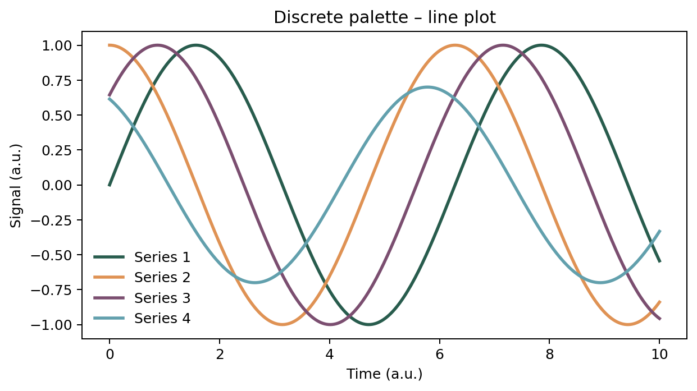
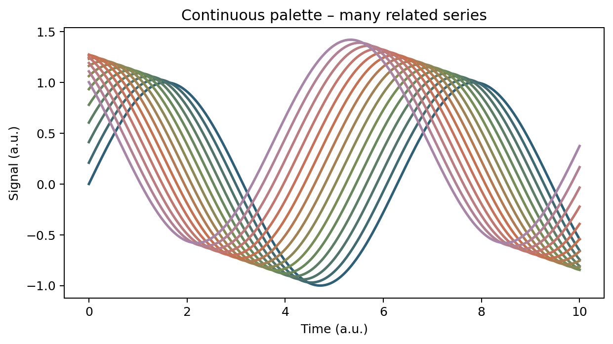
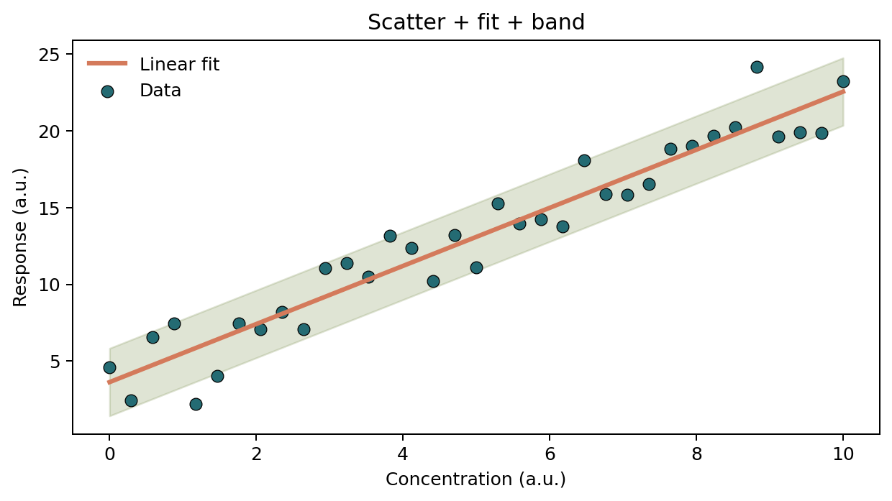
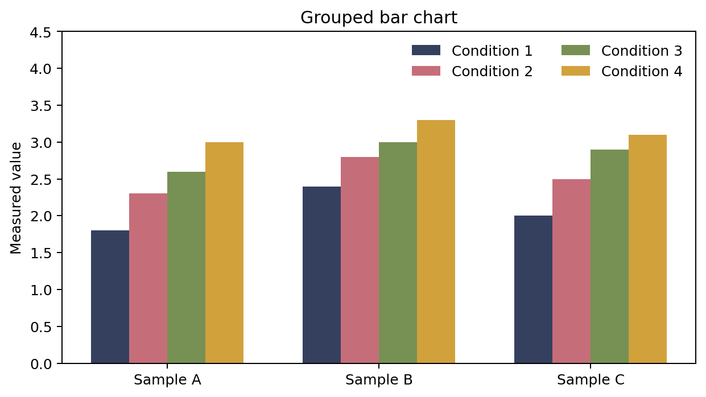
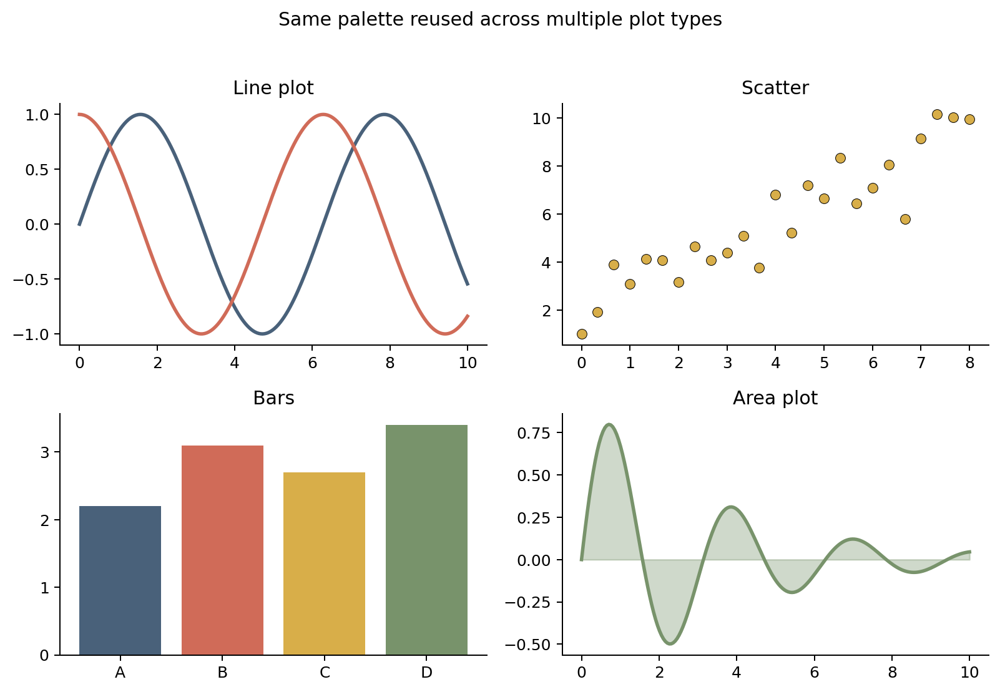
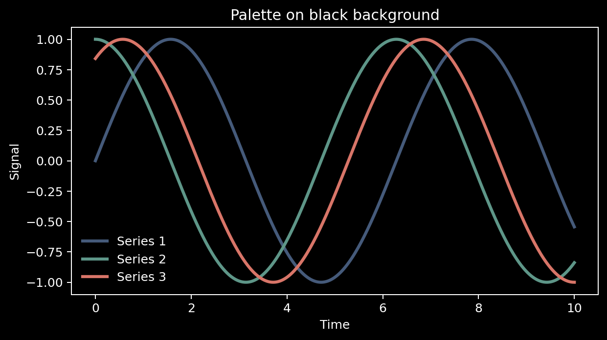

# Palette Engine

> Original color combinations for clearer, more balanced scientific plots, ready for Matplotlib.

Plots should be part of scientific communication, not an afterthought. Yet figures and posters often display mismatched colors, weak contrast, overly heavy palettes, or the same default software colors repeated everywhere. Palette Engine is a small Python utility for choosing more deliberate combinations without rebuilding a color scheme for every graph.

The repository includes 35 original palettes with two to five colors. It can return discrete Matplotlib colors, interpolate a larger continuous palette in CIELAB space, filter palettes against light or dark backgrounds, and provide approximate CMYK values for early print planning. Some examples of color combinations present in the tool:



## What it does

- supplies two- to five-color palettes
- returns normalized RGB tuples ready for Matplotlib
- selects a suitable palette automatically or by stable ID
- creates longer continuous palettes by perceptual interpolation
- filters anchor colors by contrast against white, black, or a custom RGB background
- provides approximate CMYK tuples for convenience
- keeps every bundled color combination in one transparent, tested data file

## Installation

Palette Engine supports Python 3.11 and newer.

```bash
git clone https://github.com/Dbuns/palette-engine.git
cd palette-engine
python -m pip install -e .
```

NumPy and Matplotlib are installed as project dependencies.

## Basic usage

Choose a specific three-color palette:

```python
from colors_engine import get_palette
from colors_source import palettes

colors, palette_id = get_palette(
    palettes,
    size=3,
    palette_id="PE023",
    mode="s",
)

print(palette_id)
print(colors)
```

Use the result directly in Matplotlib:

```python
import matplotlib.pyplot as plt

for index, color in enumerate(colors):
    plt.plot([0, 1, 2], [index, index + 1, index + 0.4], color=color)

plt.show()
```

Select a compatible palette randomly:

```python
colors, palette_id = get_palette(
    palettes,
    size=4,
    palette_id="r",
    background="white",
)
```

Generate 15 related colors from four anchors:

```python
colors, palette_id = get_palette(
    palettes,
    size=4,
    n_out=15,
    palette_id="PE034",
)
```

Access the original RGB values directly:

```python
rgb_colors = [
    color["rgb"]
    for color in palettes["PE029"]["colors"].values()
]
```

## Examples

### Discrete series



### Continuous interpolation



### Scatter, fit, and uncertainty band



### Grouped bars



### Reusing one palette across a figure



### Dark background



## Browse the palettes

```python
from colors_engine import show_palettes
from colors_source import palettes

show_palettes(
    palettes,
    size=4,
    mode="s",
    background="white",
)
```

The first color in each palette is treated as dominant, the second as secondary, and remaining colors as accents. These roles determine the returned order (they are suggestions rather than restrictions).

## Print mode

```python
cmyk_colors, palette_id = get_palette(
    palettes,
    size=3,
    palette_id="PE023",
    mode="p",
)
```

CMYK output is an approximate mathematical conversion from sRGB. Final print work should use an appropriate color profile and proofing workflow for the intended press, ink, and paper.

## Visual examples

Run one example at a time:

```bash
python plot_examples.py discrete
python plot_examples.py continuous
python plot_examples.py scatter
python plot_examples.py bars
python plot_examples.py heatmap
python plot_examples.py multi
python plot_examples.py dark
python plot_examples.py gallery
```

Importing `plot_examples` does not create figures or open windows.

## Tests

The automated suite checks the exact 35-palette collection, schema and value ranges, palette selection, interpolation, input validation, print output, and independent rendering of every plot example.

```bash
python -m unittest discover -s tests -v
```

GitHub Actions runs the same checks on Python 3.11 and 3.13 for every push and pull request.

## Repository structure

```text
palette-engine/
├── colors_source.py       # the 35 original palettes
├── colors_engine.py       # selection, interpolation, and contrast tools
├── plot_examples.py       # independent plotting examples
├── figures/
├── tests/
├── PALETTE_PROVENANCE.md
├── CITATION.cff
└── pyproject.toml
```

## Provenance and responsible use

The public repository contains only the project's original palette collection. Its origin and size distribution are documented in [PALETTE_PROVENANCE.md](PALETTE_PROVENANCE.md).

The palettes are ready to use, but their application still requires scientific judgment. Researchers should select, subset, or reorder colors so that the visual progression matches the meaning of the data. Sequential scales should have an intuitive progression, diverging scales should use a meaningful midpoint, and established disciplinary color conventions should be respected where relevant.

Background filtering checks contrast between the chosen anchor colors and the requested background. It does not guarantee accessibility for every viewer, distinguishability under all forms of color-vision deficiency, or readability after interpolation. Important categories should also be distinguished with labels, markers, line styles, or patterns.

## Licence and citation

Palette Engine is available under the [MIT License](LICENSE). Citation metadata is provided in [CITATION.cff](CITATION.cff).
